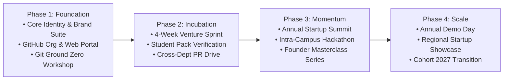

<div align="center">


<br/><br/>

[](https://github.com/ues-sahiwal)
[](https://uosahiwal.edu.pk)
[](https://github.com/ues-sahiwal)
[](https://github.com/ues-sahiwal)
[](https://instagram.com/ues.sahiwal)
[](https://github.com/ues-sahiwal/ues-brand-assets)

<br/>

**ENTREPRENEURSHIP • INNOVATION • TECHNOLOGY**  
*Empowering Student Founders — Where Ideas Become Ventures.*  
`Think. Build. Launch.`

---

**The premier cross-disciplinary, student-led entrepreneurship & venture ecosystem at the University of Sahiwal.**  
Connecting ambitious students from all academic departments with modern technology, startup methodologies, and global founder networks.

<br/>

[🎯 Mission & Vision](#-mission--vision) •
[🏛️ Core Pillars](#-core-pillars) •
[📦 Repositories](#-organization-repositories) •
[📋 Flagship Programs](#-flagship-programs--events) •
[🗺️ Roadmap](#-roadmap-20262027) •
[🤝 Leadership](#-leadership--governance) •
[🚀 Get Involved](#-get-involved)

</div>

---

## 🎯 Mission & Vision

> **Our Mission:**  
> *"To empower student founders at the University of Sahiwal by providing the resources, technical infrastructure, mentorship, and community needed to build real, venture-scale solutions on campus."*

> **Our Vision:**  
> *"To cultivate the leading university entrepreneurship ecosystem in Pakistan, ensuring every student with an idea has a verified pathway to build, fund, and launch it."*

---

## 🏛️ Core Pillars

Innovation thrives at the intersection of diverse disciplines. Whether your foundation is in **Computer Science**, **Business Administration**, **Economics**, **Mathematics**, or **English**, UES provides the framework and platform to build, lead, and scale.

| Pillar | Focus Area | What Members Achieve |
| :---: | :--- | :--- |
| 🚀 | **Entrepreneurship** | **Venture Incubation & Commercialization**<br/>Transform raw concepts into validated business models, customer discovery loops, financial models, and investor pitch decks. |
| 💡 | **Innovation** | **Problem Solving & Design Thinking**<br/>Apply agile execution and rapid prototyping to solve real challenges within campus, regional commerce, and national technology sectors. |
| 🤖 | **Technology** | **Modern Software & Emerging Tech**<br/>Bridge theory with practice: Git version control, collaborative GitHub workflows, AI architectures, and full-stack web applications. |
| 🎤 | **Professional Skills** | **Executive Communication & Leadership**<br/>Master public speaking, client negotiation, team leadership, cross-faculty coordination, and large-scale event operations. |
| 🌐 | **Ecosystem Access** | **Mentorship & Industry Connections**<br/>Connect directly with proven startup founders, remote tech architects, university alumni, and venture capital networks. |

---

## 📦 Organization Repositories

Explore the open-source infrastructure, design systems, and public codebases powering the UES ecosystem:

| Repository | Description | Primary Stack | Direct Link |
| :--- | :--- | :--- | :---: |
| [`.github`](https://github.com/ues-sahiwal/.github) | **Organization Central Hub** — Public profile view, community health standards, contributing guidelines, and GitHub Campus Expert blueprint. | Markdown, GitHub Standards | [Explore ➔](https://github.com/ues-sahiwal/.github) |
| [`website`](https://github.com/ues-sahiwal/website) | **Official Web Portal** — Accelerator-grade web presence featuring fluid Lenis inertia scrolling, GSAP choreography, and Astro islands. | Astro 5.4, React 19, Tailwind CSS v4, GSAP | [Explore ➔](https://github.com/ues-sahiwal/website) |
| [`ues-brand-assets`](https://github.com/ues-sahiwal/ues-brand-assets) | **Brand & Visual Identity Vault** — Scalable SVG vector suite, color system (`#0A1F44` & `#F5B301`), pitch decks, merchandise mockups, and event signage. | SVG Vectors, Brand Standards, Assets | [Explore ➔](https://github.com/ues-sahiwal/ues-brand-assets) |

---

## 📋 Flagship Programs & Events

<table>
<tr>
<td width="50%" valign="top">

### 🏛️ Annual Startup Summit 2026
Our flagship annual gathering at the **Main Auditorium, University of Sahiwal** (Nov 24, 2026). Features keynote addresses from national ecosystem leaders, interactive panel discussions, and a high-stakes student venture showcase.

</td>
<td width="50%" valign="top">

### 🛠️ Developer Sprints & "Git Ground Zero"
Practical workshops helping students master collaborative version control, open-source pull requests, and navigating verification for the **GitHub Student Developer Pack** without institutional student email barriers.

</td>
</tr>
<tr>
<td width="50%" valign="top">

### 💡 4-Week Venture Incubation Track
A guided sprint taking cross-departmental student teams through customer discovery, problem-solution fit, MVP prototyping, unit economics, and pitch deck preparation.

</td>
<td width="50%" valign="top">

### ⚡ Intra-Campus Hackathons
High-energy, 48-hour multidisciplinary build marathons where developers, designers, and business strategists collaborate under real-time constraints to build working solutions.

</td>
</tr>
</table>

---

## 🗺️ Roadmap (2026–2027)



| Phase | Timeline | Focus Area | Core Deliverables |
| :--- | :--- | :--- | :--- |
| **Phase 1: Foundation** | Q1–Q2 2026 | Infrastructure & Identity | Launch UES brand suite, deploy official portal, onboard founding cohort, deliver *Git Ground Zero* bootcamp. |
| **Phase 2: Incubation** | Q2–Q3 2026 | Technical & Business Depth | 4-week venture incubation track, GitHub Student Pack verification support, first open-source contribution drive. |
| **Phase 3: Momentum** | Q3–Q4 2026 | High-Impact Campus Events | Host the **Annual Startup Summit 2026**, run 48-hour campus hackathon, and deliver external industry founder panels. |
| **Phase 4: Scale** | Q4 2026–2027 | Ecosystem Demo & Growth | Student Venture Demo Day, commercial pre-seed pipeline, executive council succession for Cohort 2027. |

---

## 🤝 Leadership & Governance

UES operates under the institutional guidance of the **Directorate of Student Affairs (DSA)** at the University of Sahiwal, driven by student leads and multidisciplinary faculty advisors.

```
               ┌──────────────────────────────────────────────┐
               │         Founder & Executive Board            │
               │  Ashar Iftikhar (President) • VP Operations  │
               └──────────────────────┬───────────────────────┘
                                      │
               ┌──────────────────────▼───────────────────────┐
               │           Functional Directors               │
               │  Technical Programs • Incubation & Strategy  │
               │         Campus Affairs • Design & Media      │
               └──────────────────────┬───────────────────────┘
                                      │
               ┌──────────────────────▼───────────────────────┐
               │          General Cohort & Fellows            │
               │  Venture Builders • Developers • Designers   │
               └──────────────────────────────────────────────┘
```

* **Founder & President:** Ashar Iftikhar (*BS Computer Science*)
* **Institutional Governance:** Directorate of Student Affairs (DSA), University of Sahiwal
* **Faculty Advisory:** Faculty of Computing & Information Technology • Faculty of Economics & Management Sciences

---

## 🎨 Official Brand Palette

| Token | Swatch | HEX | RGB | Role |
| :--- | :---: | :---: | :---: | :--- |
| **UES Primary Navy** | `■` | `#0A1F44` | `rgb(10, 31, 68)` | Institutional authority, primary backgrounds & text |
| **UES Growth Gold** | `■` | `#F5B301` | `rgb(245, 179, 1)` | Ascending opportunity, growth arrows, highlights & badges |
| **UES Midnight Navy** | `■` | `#051024` | `rgb(5, 16, 36)` | Deep UI surfaces & radial vignette backgrounds |
| **UES Pure White** | `■` | `#FFFFFF` | `rgb(255, 255, 255)` | Primary letterforms (`U`, `E`, `S`) & dark-mode text |

---

## 💬 Frequently Asked Questions (FAQ)

**What is UES?**  
UES stands for **UOSahiwal Entrepreneurship Society** — the premier student-led venture and technology society at the University of Sahiwal, Punjab, Pakistan.

**What does UES do?**  
We organize practical developer bootcamps, intra-university hackathons, 4-week startup incubation cohorts, and industry masterclasses to help students turn ideas into launch-ready ventures.

**Who can join UES?**  
Any currently enrolled student at the University of Sahiwal across all departments — Computer Science, Business Administration, Economics, Mathematics, English, and more. Zero prior startup or coding experience is required.

**How do I get started?**  
Star our repositories, attend our hands-on workshops, and connect with us on Instagram at [`@ues.sahiwal`](https://instagram.com/ues.sahiwal).

---

## 🚀 Get Involved

We maintain a zero-barrier, merit-first community culture. You do not need prior coding experience or a business degree to take part:

1. **⭐ Star & Watch Our Repositories:** Keep up with codebases, workshop curricula, and starter kits across the organization.
2. **📱 Connect on Social:** Follow our official updates and event drops on Instagram at [`@ues.sahiwal`](https://instagram.com/ues.sahiwal).
3. **🛠️ Make Your First Contribution:** Submit ideas, participate in issues tagged `good first issue`, and join our active build sessions.

---

<div align="center">


### UOSahiwal Entrepreneurship Society (UES)
*Empowering Student Founders • University of Sahiwal, Pakistan*

📧 **Email:** [ashar.iftikhar@uosahiwal.edu.pk](mailto:ashar.iftikhar@uosahiwal.edu.pk)  
📷 **Instagram:** [@ues.sahiwal](https://instagram.com/ues.sahiwal) • 🌐 **GitHub:** [github.com/ues-sahiwal](https://github.com/ues-sahiwal)

<sub>© 2026 UOSahiwal Entrepreneurship Society. Built by students, for students.</sub>

</div>
