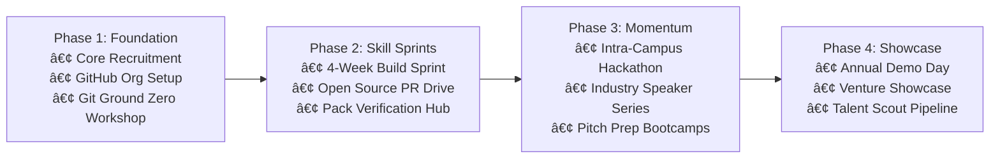

# 🏛️ UES — UOSahiwal Entrepreneurship Society

### UNIVERSITY OF SAHIWAL · SAHIWAL, PUNJAB, PAKISTAN

**The official student-led entrepreneurship, innovation & technology society of the University of Sahiwal.**

**THINK. BUILD. LAUNCH.** — *Entrepreneurship • Innovation • Technology*

---

**UES** is a cross-disciplinary, student-led entrepreneurship and innovation community at the **University of Sahiwal** in Punjab, Pakistan. We unite students from Computing, Management Sciences, and Humanities with the modern tech, venture, and business ecosystem.

[🎯 Mission](#-our-mission) •
[🏛️ What We Do](#-what-we-do) •
[📋 Flagship Programs](#-flagship-programs) •
[🗺️ Roadmap](#-roadmap-20262027) •
[🤝 Roles](#-community-roles) •
[❓ FAQ](#-faq) •
[🚀 Get Involved](#-get-involved)

---

## 🎯 Our Mission

> *"To empower students across disciplines to develop entrepreneurial mindsets, explore emerging technologies, transform ideas into meaningful ventures, and build the skills and connections needed to create real-world impact."*

---

## 🏛️ What We Do

We believe innovation doesn't belong to a single department. Whether you study **Business Administration**, **Computer Science**, **English**, **Economics**, or **Mathematics**, there is a place for you to build and lead.

| Pillar | Focus | What Members Achieve |
| :---: | :--- | :--- |
| 🚀 | **Entrepreneurship** | **Start & Grow Businesses** Turn raw concepts into validated business models, pitch decks, and viable ventures. |
| 💡 | **Innovation** | **Solve Problems & Develop Ideas** Apply design thinking, agile execution, and rapid prototyping to campus and regional challenges. |
| 🤖 | **Technology** | **Explore AI, Software & Emerging Tech** Demystify code, version control, AI systems, full-stack tools, and digital product workflows. |
| 🎤 | **Professional Skills** | **Communication, Sales & Leadership** Master public speaking, client negotiation, team management, and professional networking. |
| 🌐 | **Opportunities** | **Connect with the Ecosystem** Bridge the gap with industry founders, alumni mentors, investor networks, and global programs. |

---

## 📋 Flagship Programs

<table>
<tr>
<td width="50%" valign="top">

### 🛠️ Hands-on Tech & Dev Sprints
Practical bootcamps taking students from Ground Zero to practical software development. Covers Git, collaborative version control, open source, and building web/AI products.

</td>
<td width="50%" valign="top">

### 💡 Venture Incubation Tracks
Structured pathways guiding student teams through ideation, market validation, MVP creation, and commercial launch with founder mentorship.

</td>
</tr>
<tr>
<td width="50%" valign="top">

### âš¡ Intra-University Hackathons
High-energy, cross-department build marathons where engineers, designers, and business strategists team up to solve problems and demo live in 48 hours.

</td>
<td width="50%" valign="top">

### 🎙️ Founder Talks & Industry Panels
Interactive masterclasses with entrepreneurs, freelancers, tech leads, and alumni sharing real-world playbooks on client acquisition, remote careers, and startup growth.

</td>
</tr>
</table>

---

## 🗺️ Roadmap (2026–2027)

| Phase | Timeline | Focus Area | Core Deliverables |
| :--- | :--- | :--- | :--- |
| **Phase 1: Foundation** | Q1 | Community Infrastructure | Launch organization hub, onboard founding team, deliver *Git Zero to Hero* workshop. |
| **Phase 2: Skill Sprints** | Q2 | Technical & Business Depth | 4-week product sprint, first contribution drive, student developer pack onboarding. |
| **Phase 3: Momentum** | Q3 | High-Impact Campus Events | Campus-wide Hackathon, venture pitching competition, external industry panels. |
| **Phase 4: Showcase** | Q4 | Incubation & Demo Day | Student Demo Day, seed showcase for student projects, annual society transition. |

---

## 🤝 Community Roles

* **Core Team & Leads:** Drive operations, event execution, partnerships, and society governance.
* **Project Maintainers:** Oversee organization repositories, review pull requests, and mentor newcomers.
* **General Members & Fellows:** Attend workshops, collaborate in cross-functional teams, and build public portfolios.

---

## ❓ FAQ

**What is UES?**
UES stands for **UOSahiwal Entrepreneurship Society** — the official student-led entrepreneurship and innovation society of the University of Sahiwal, Punjab, Pakistan.

**What does UES do?**
UES organizes workshops, hackathons, venture incubation tracks, and founder talks to help students build entrepreneurial and technical skills.

**Who can join UES?**
Any student of the University of Sahiwal across any discipline — Computing, Management Sciences, Humanities, and more. No prior experience is required.

**Where is UES located?**
UES is based at the University of Sahiwal, Sahiwal, Punjab, Pakistan.

---

## 🚀 Get Involved

We follow an open, collaborative standard. Getting involved takes just three steps:

1. **⭐ Follow & Star:** Star our repositories to stay updated with codebases, workshop materials, and templates.
2. **💬 Engage in Discussions:** Connect with fellow students in repository discussions, suggest workshop topics, or pitch an idea.
3. **🛠️ Make Your First Contribution:** Check out our open issues tagged `good first issue` to start contributing.

> 🎓 **Zero Barrier to Entry:**
> You don't need prior coding experience or a business degree to join. If you have curiosity and drive, you have a place here.

---

**UES — UOSahiwal Entrepreneurship Society**
*University of Sahiwal — Sahiwal, Punjab, Pakistan*
📧 Contact: [ashiriftikharofficial@gmail.com](mailto:ashiriftikharofficial@gmail.com) • 🌐 GitHub: [github.com/ues-sahiwal](https://github.com/ues-sahiwal)

Built with passion by students, for students.

