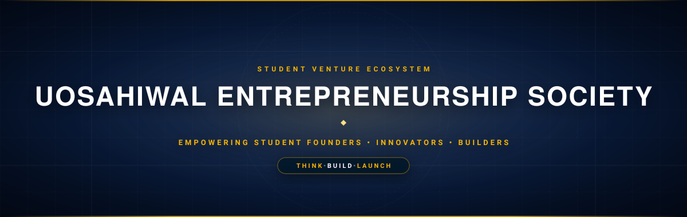

  

# UOSahiwal Entrepreneurship Society

The student-led venture incubation and applied software engineering collective at the University of Sahiwal.

---

## Mandate

University students possess immense intellectual drive, but traditional coursework often isolates learning into theoretical silos without distributed team workflows or product execution.

The **UOSahiwal Entrepreneurship Society (UES)** formalizes the campus builder community. We provide the operational infrastructure, technical workshops, and mentorship required to transition student projects from local files into tested open-source repositories and sustainable ventures.

---

## Core Pillars

| Practice | Focus | Delivery |
| :--- | :--- | :--- |
| **Venture Incubation** | Early-stage concept validation | Discovery sprints, market validation, and pitch preparation for student founders. |
| **Applied Engineering** | Distributed software workflows | Version control with Git, feature branching, code reviews, and automated CI pipelines. |
| **Developer Access** | Institutional tooling onboarding | Guidance for navigating manual student verification for GitHub Student Developer Packs and cloud credits. |
| **Executive Panels** | Practical industry insight | Direct masterclasses with software engineers, venture founders, and university alumni. |

---

## Active Campus Initiatives

### Git Ground Zero
An intensive two-hour hands-on bootcamp equipping attendees with authenticated local environments (SSH/PAT), terminal fluency, branch isolation, and their first merged Pull Request on an organization sandbox.

### Annual Startup Summit
A multi-track gathering hosted at the University of Sahiwal Main Auditorium, featuring keynote addresses, panel discussions on regional commerce, and live venture pitches before industry judges.

### Intra-Campus Hackathons
Forty-eight-hour cross-disciplinary sprints where software developers, economists, and designers collaborate to build and ship functioning prototypes addressing local community problems.

### First Contribution Sandbox
Dedicated practice repositories giving incoming students a zero-barrier environment to practice opening issues, participating in peer code reviews, and submitting documentation fixes.

---

## Cross-Disciplinary Cohort

UES is open to all enrolled students across the University of Sahiwal. Innovation is not the domain of any single academic department:

- **Computing and IT:** System architecture, software implementation, and open-source contribution.
- **Management and Business:** Financial modeling, market analysis, and product positioning.
- **Economics and Mathematics:** Quantitative research, algorithmic optimization, and unit economics.
- **Humanities and Social Sciences:** User research, ethical communication, and community operations.

Prior programming or business experience is not required. Commitment and curiosity are the only prerequisites.

---

## Directory and Channels

| Channel | Reference |
| :--- | :--- |
| **Institution** | University of Sahiwal, Sahiwal, Punjab, Pakistan |
| **Leadership** | Ashar Iftikhar, President ([ashar.iftikhar@uosahiwal.edu.pk](mailto:ashar.iftikhar@uosahiwal.edu.pk)) |
| **Code Repositories** | [github.com/ues-sahiwal](https://github.com/ues-sahiwal) |
| **Community Updates** | [instagram.com/ues.sahiwal](https://instagram.com/ues.sahiwal) |
| **Parent Portal** | [uosahiwal.edu.pk](https://uosahiwal.edu.pk) |

 

  

  University of Sahiwal Entrepreneurship Society &mdash; Official Campus Organization Hub

